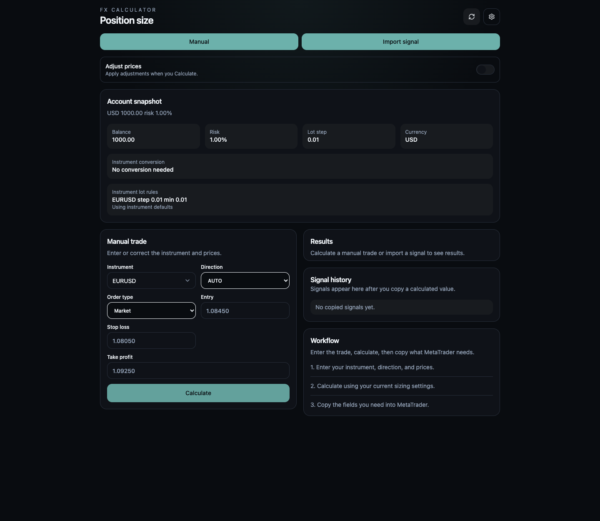
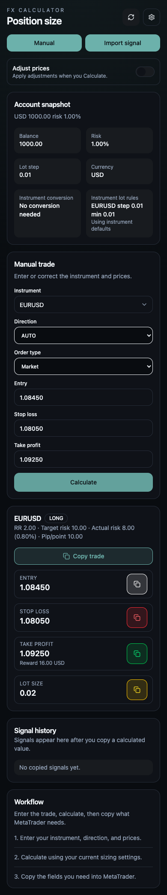

# FX Calculator

**From trade idea to position size.** An Android-first calculator for sizing forex, metals, indices, commodities, crypto CFDs, and equity CFDs against a defined account risk.

[](https://github.com/jakkarudev/fx-calculator/actions/workflows/ci.yml)
[](https://jkrdev.com)

Built by [JKRDev](https://jkrdev.com). This project brings a typed calculation engine, a responsive React interface, and native Android screenshot recognition into one workflow.



<details>
<summary><strong>Mobile view</strong> — responsive layout at 390 px wide</summary>

Captured in a mobile-width browser viewport, showing Manual entry and calculated results.



</details>

## Features

- **Manual trades:** search the instrument catalog, enter prices, choose Long, Short, or Auto direction, and calculate explicitly.
- **Signal imports:** extract a trade from pasted text or an Android screenshot, then correct the detected values.
- **Risk-based sizing:** calculate lots, stop and target distances, reward-to-risk ratio, and actual monetary and percentage risk after volume rounding.
- **Instrument specifications:** use a bundled FTMO public catalog snapshot with canonical symbols, aliases, contract sizes, profit currencies, and price precision.
- **Account settings:** configure USD or EUR accounts, risk percentage, currency conversion, and instrument-specific sizing overrides.
- **Optional price adjustments:** compare original and adjusted results with price-structure, risk, and reward-ratio guards.
- **Copy and history:** copy result values for your trading platform; copying saves the calculated trade locally, with up to 50 entries.
- **Light and dark themes:** use the same responsive interface in the browser and the Capacitor Android app.

The application calculates trade parameters; it does not connect to a broker or execute orders. Screenshot OCR is Android-only. Manual entry and pasted-text imports work in the web version.

## Quick start

Use **Node.js 24** and npm, matching CI. No API keys, environment variables, database, or backend server are required.

```bash
git clone https://github.com/jakkarudev/fx-calculator.git
cd fx-calculator
npm ci
npm run dev
```

Open the local URL printed by Vite. To try a calculation without currency conversion, select a USD account in Settings, set the balance to **10,000** and risk to **1%**, then enter:

| Field       | Value   |
| ----------- | ------- |
| Instrument  | EURUSD  |
| Direction   | Long    |
| Entry       | 1.08450 |
| Stop loss   | 1.08050 |
| Take profit | 1.09250 |

With default EURUSD specifications and adjustments disabled, the result is **0.25 lots**, **$100 actual risk**, and a **2:1 reward-to-risk ratio**. See the [usage guide](docs/usage.md).

## Engineering

| Layer          | Technology and responsibility                                                                      |
| -------------- | -------------------------------------------------------------------------------------------------- |
| Interface      | React 19, TypeScript, Tailwind CSS 4, Lucide icons, local UI primitives                            |
| Domain         | Pure TypeScript parsing, validation, instrument rules, conversion routing, sizing, and adjustments |
| Native app     | Capacitor 8, Java Android plugin, bundled Google ML Kit text recognition                           |
| Persistence    | Capacitor Preferences with browser localStorage fallback                                           |
| Exchange rates | Frankfurter HTTP requests, timeout handling, cache, and rate provenance                            |
| Tooling        | Vite 8, Vitest, React Testing Library, ESLint, Prettier, GitHub Actions                            |

Manual and imported trades share a calculation boundary. The domain layer is independent of React and platform APIs; browser and native capabilities are isolated in adapters. Tests cover calculations, parsing, catalog projection, conversion failures, overrides, draft restoration, history, and user workflows.

Read the [architecture guide](docs/architecture.md) and [calculation reference](docs/calculations.md) for the implementation and its tradeoffs.

## Development

```bash
npm run format:check
npm run check
```

`check` runs type checking, linting, tests, and a production web build. CI also runs formatting and Android unit tests, lint, and debug APK assembly.

```bash
npm run build
npm run preview
```

The web build is written to `dist/`. For Android, install Java 21 and the Android SDK, then follow the [development and deployment guide](docs/development.md).

## Documentation

- [Usage](docs/usage.md) — manual entry, signal imports, settings, and history.
- [Calculations](docs/calculations.md) — formulas, rounding, conversion reliability, and catalog limitations.
- [Architecture](docs/architecture.md) — module boundaries, data flow, and source layout.
- [Development and deployment](docs/development.md) — commands, Android setup, static hosting, and troubleshooting.
- [Privacy](docs/privacy.md) — local data, screenshots, clipboard access, and external requests.
- [Contributing](CONTRIBUTING.md) — issue reports and contribution checks.
- [Security](SECURITY.md) — private vulnerability reporting.
- [Third-party notices](THIRD_PARTY_NOTICES.md) — dependencies and catalog attribution.

## Scope and limitations

The instrument catalog is a **2026-10-07 snapshot**, not a live broker feed. Some minimum volumes and lot steps are compatibility defaults or historical values, rather than verified current platform specifications. Verify them against your broker and configure overrides where needed. FX Calculator is an independent project and is not affiliated with FTMO.

Calculations do not model commissions, spread, slippage, swaps, margin requirements, or guaranteed execution at the stop price. Currency rates are reference conversion inputs, not streaming trading quotes. See [calculation limitations](docs/calculations.md#limitations).

## Author

Created and maintained by **[JKRDev](https://jkrdev.com)**.

[Portfolio](https://jkrdev.com) · [GitHub](https://github.com/jakkarudev) · [Report an issue](https://github.com/jakkarudev/fx-calculator/issues)

## License

No open-source license has been granted for the original project code. Public visibility allows inspection; it does not grant permission to reuse or redistribute the code. For licensing inquiries, contact [JKRDev](https://jkrdev.com). Third-party material retains its own terms; see [Third-party notices](THIRD_PARTY_NOTICES.md).
