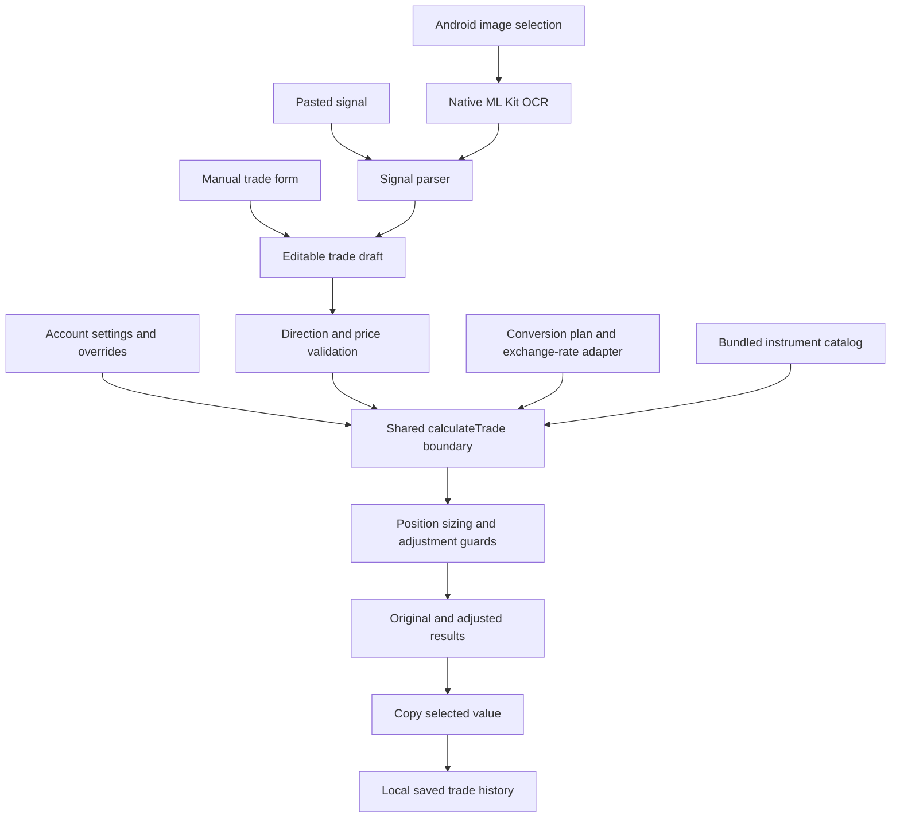

# Architecture

FX Calculator uses one position-sizing domain with a React presentation layer and browser/native adapters. [CONTEXT.md](../CONTEXT.md) defines the shared terminology.

## Data flow

## Module boundaries

| Location                                          | Responsibility                                                                             |
| ------------------------------------------------- | ------------------------------------------------------------------------------------------ |
| `src/domain/fx/`                                  | Instrument normalization, catalog, parsing, validation, valuation, sizing, and adjustments |
| `src/features/calculator/`                        | Orchestration, forms, settings, drafts, results, and history                               |
| `src/features/calculator/calculate-trade.ts`      | Shared validated calculation boundary requiring reliable valuation                         |
| `src/features/calculator/trade-draft.ts`          | Text-preserving drafts, domain conversion, serialization, and migration                    |
| `src/lib/`                                        | Preferences, exchange rates, clipboard, and OCR adapters                                   |
| `src/components/`                                 | Theme and reusable UI primitives                                                           |
| `android/app/src/main/java/com/fxcalculator/app/` | Android entry point, OCR plugin, and image decoding                                        |
| `src/domain/fx/catalog-source/`                   | Raw public evidence, manifest, and runtime projection                                      |
| `scripts/`                                        | Offline catalog projection tooling                                                         |
| `.github/workflows/ci.yml`                        | Web and Android validation                                                                 |

Domain functions receive values rather than reading storage, calling HTTP, or depending on React. This keeps formulas independently testable. `CalculatorScreen` coordinates platform calls and state; `calculateTrade` applies validation and shared sizing settings.

## Catalog strategy

Runtime loads a checked-in projection of a captured FTMO public response. Normal catalog use is deterministic and independent of source availability. Projection is generated offline and never refreshed automatically.

Canonicalization handles recognized account decorations and preserves meaningful symbol suffixes. Source anomalies and legacy aliases are handled explicitly. Valid forex pairs outside the picker retain dynamic compatibility; unknown nonforex symbols cannot inherit generic forex contracts.

See the [capture policy](../src/domain/fx/catalog-source/README.md) for provenance, volume defaults, alias corrections, and precision policy.

## Persistence and platform services

Capacitor Preferences stores settings, drafts, and saved trades, with localStorage as a browser fallback. Draft restoration migrates the earlier imported-signal format. History is bounded and validates restored entries.

The rate adapter caches conversions in memory for 15 minutes, uses an eight-second request timeout, and can return an existing cached rate marked stale after a request failure. Android can fall back to Capacitor's native HTTP transport. EUR/USD rate provenance is also stored with settings.

The Android OCR plugin receives a selected image as a data URL, decodes it, and runs bundled Latin text recognition with ML Kit. The web implementation reports that OCR requires Android. Clipboard access also uses a platform adapter.

## Verification strategy

Vitest covers domain behavior and adapter failure paths. React Testing Library covers user workflows, instrument selection, conversion reliability, drafts, adjustments, and history. Android JUnit tests cover image decoding. CI validates the web project and Android debug build; it does not publish deployments or signed releases.
